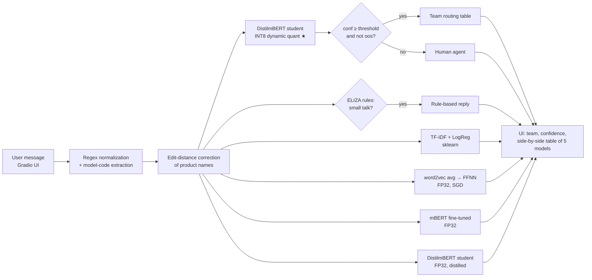

# Customer Support Ticket Router (TR / EN) – SWE015 Use Case 2

A home-appliance brand receives support messages in Turkish and English. This app **normalizes** each
message, **predicts the intent** with a confidence score and **routes it to the right team**.
Low-confidence / out-of-scope messages go to a **human agent**; greetings and small talk get an
**ELIZA-style rule-based reply**. All models' predictions are shown side by side; the routing
decision is made by the **INT8-quantized distilled Transformer**.

## Setup & run

```bash
git clone https://github.com/dilrubaw/support-router.git
cd support-router
pip install -r requirements.txt
python app.py            # downloads trained weights from Hugging Face Hub on first run
```
Model weights: https://huggingface.co/dilrubaw/support-router-models (not stored in this repo).
On Google Colab use `python app.py --share` to get a public link.

### Re-train everything (optional, GPU recommended, ~30–45 min on a Colab T4)
```bash
python train_all.py      # prepare data → 5 models → quantize → evaluate
```
Results are written to `results/` (`results_table.md`, `hardware.txt`, `errors_student_int8.csv`).

## Architecture


Everything runs on **CPU** at inference time (training on GPU).

## Technique map

| Area | Technique | Where in code |
|---|---|---|
| A – Neural networks | Feedforward net on averaged word2vec, SGD + backprop, dropout | `src/train_ffnn.py`, `src/ffnn_model.py` |
| B – Classical NLP | Regex normalization, model-code extraction, tokenization | `src/preprocess.py` |
| B | Minimum edit distance spelling correction of product names | `src/preprocess.py` |
| B | ELIZA-style rules for greetings / small talk | `src/eliza.py` |
| B | TF-IDF + logistic regression baseline | `src/train_baseline.py` |
| B | Own word2vec (skip-gram, negative sampling), cosine similarity | `src/train_word2vec.py` |
| C – Transformers | Fine-tuning multilingual BERT (WordPiece) with a classification head | `src/train_teacher.py` |
| D – Efficient models | Knowledge distillation mBERT → DistilmBERT | `src/distill.py` |
| D | Dynamic INT8 quantization; size/latency benchmark | `src/quantize.py`, `src/evaluate.py` |

## Evaluation protocol
* Same held-out test set for all models: CLINC150 `plus` test split (incl. 1,000 out-of-scope) + 20 % of our own TR/EN appliance messages.
* Confidence threshold per model is tuned on the **validation** set only.
* Metrics: accuracy, in-scope accuracy, **out-of-scope recall**, accuracy on appliance and Turkish messages, model size (MB), CPU latency (batch 1, mean of 100 runs). See `results/`.

## Data
* **CLINC150** – Larson et al., *An Evaluation Dataset for Intent Classification and Out-of-Scope Prediction*, EMNLP 2019. Loaded from Hugging Face (`clinc/clinc_oos`, config `plus`).
* **data/custom_appliance.csv** – 120 hand-written Turkish/English appliance support messages (4 intents: fault, installation, warranty, spare parts), split 60/20/20.

## Models
* Teacher: `bert-base-multilingual-cased` (Devlin et al., 2019)
* Student: `distilbert-base-multilingual-cased` (Sanh et al., 2019)
